# 자금세탁과 크립토 — 강의 자료 정리

> 원본: 「크립토 리터러시 6기 5·6교시」 강의 슬라이드 (오태민, PDF 111쪽)
> 본문의 (p.N)은 원본 PDF 쪽 번호. 이미지는 원본 PDF에서 발췌(사진은 원본 그대로, 도표는 슬라이드 렌더링)

## 한눈에 보기

| Part | 주제 | 쪽 | 핵심 메시지 |
|---|---|---|---|
| 1 | 장부 · 런던 시티 | 1–31 | 런던은 금고가 아니라 '국경을 넘는 사법(私法)'을 팔아 유로달러 시장의 중심이 됨 |
| 2 | 섬들의 돌파구 | 32–59 | 은행비밀을 잃은 유럽 역외(저지·맨섬·지브롤터·몰타·스위스)가 크립토를 다음 상품으로 삼음 |
| 3 | 배관의 장악 | 60–74 | 미국의 관할력은 영토가 아니라 달러 결제 배관(뉴욕 청산)에서 나옴 |
| 4 | 구조적 권력과 달러 스테이블코인 | 75–106 | 스테이블코인 제도화는 60년 전 유로달러와 같은 결산 — 로컬 국가의 후퇴 = 미국의 전진. 단, 이는 여유가 아니라 다급함의 표현 |
| 5 | 비트코인 4년 주기 | 107–111 | 이번 -48~50% 조정은 거품 붕괴가 아닌 제도화된 사이클의 정상 조정 |

## 핵심 논지 요약

- **공법은 국경에서 멈추고 사법은 국경을 넘음**: 거래를 금지하는 국가(공법)도 훔친 재산은 보호함(사법). 런던은 이 사법의 신뢰를 상품화함
- **역외는 늘 '다음 상품'을 찾음**: 은행비밀 → (FATCA·CRS로 퇴출) → 크립토 면허·펀드
- **달러는 바다를 건너지 않음**: 유로달러의 모든 지급은 뉴욕 장부 위에서 완결(병렬 결제) → 미국은 배관의 밸브를 쥠
- **가시성은 사라지지 않고 이동함**: 은행을 우회한 스테이블코인은 자국 감시망 밖으로 나가지만 공개 원장과 발행사 관할을 통해 워싱턴의 시야로 들어감
- **포획 전략의 역설**: 미국은 크립토를 금지 대신 제도화(ETF·GENIUS법·전략 비축)로 흡수하지만, 그 달러 스테이블코인이 불법 크립토의 84%를 차지하며 AML 방어막을 허묾

## 목차

- [Part 1. 장부 · 런던 시티](#part-1-장부--런던-시티--미국-밖에서-달러를-만들다-pp131)
- [Part 2. 섬들의 돌파구](#part-2-섬들의-돌파구--유럽의-역외는-왜-크립토에-먼저-눈을-떴는가-pp3259)
- [Part 3. 배관의 장악](#part-3-배관의-장악--fifa-사건과-유로달러의-결제-구조-pp6074)
- [Part 4. 구조적 권력과 달러 스테이블코인](#part-4-구조적-권력과-달러-스테이블코인--미국-쇠퇴론은-과장되었다-pp75106)
- [Part 5. 비트코인 4년 주기](#part-5-비트코인-4년-주기-pp107111)

---

## Part 1. 장부 · 런던 시티 — 미국 밖에서 달러를 만들다 (pp.1–31)

*템스강에서 본 런던 시티 (p.1)*

### 1-1. 유로달러: 규제 밖의 달러

**런던은 규제 밖의 달러를 팔았다 (p.3)**

- **스위스 — 은행비밀·중립**: 20세기 전반 유럽 자본의 피난처. 예금자 이름을 비공개로 두고, 전쟁 당사국에 대해서도 중립을 지킴
- **런던 — 미국법 밖에서 움직이는 달러**: 전후 쇠락한 제국의 수도가 '달러의 외국 시장'을 허용하는 방식으로 다시 무대를 얻음
- 통화는 미국 것, 규제는 미국 밖

**유로는 유럽 단일통화가 아니다 — 유로달러의 정의 (p.4)**

- 정의: 미국 밖 은행에 예치된 달러
- 런던 계좌, 바하마·싱가포르 은행의 달러도 넓은 의미의 유로달러
- 핵심: **미국 은행규제의 직접 적용을 받지 않음**

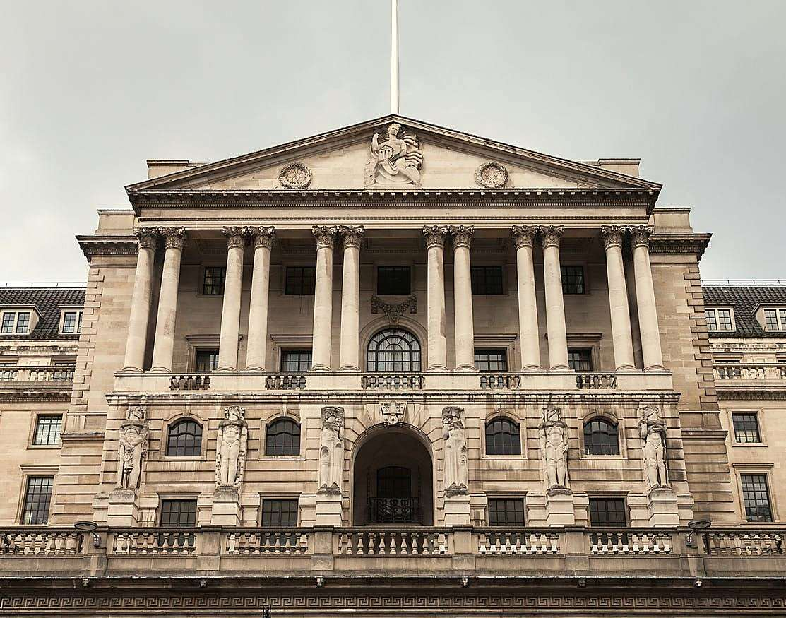
*영란은행 외관, 런던 (p.4)*

**네 개의 좌표가 흩어진다 — 역외금융의 원형 (p.5)**

| 좌표 | 내용 |
|---|---|
| 장소 | 런던 |
| 통화 | 미국 달러 |
| 고객 | 제3국 |
| 계약의 실질 | 또 다른 나라 |

→ 경제활동의 장소와 통화의 관할이 서로 떨어짐

**미국의 규제, 런던의 자유 — 레귤레이션 Q (p.6)**

| 항목 | 미국 국내 | 런던 달러시장 |
|---|---|---|
| 예금금리 상한 | 적용 | 적용 없음 |
| 지급준비 의무 | 적용 | 의무 면제 |
| 자본규제 | 적용 | 제한 약화 |
| 국제수지 제한 | 적용 | 런던에서 회피 가능 |

**런던은 세 번 벌었다 (p.7)**

1. **소련의 안전처**: 달러의 편리함 + 미국 밖이라는 법적 거리. 소련은 달러가 필요했지만 미국 내 동결을 두려워함
2. **규제의 우회로**: 미국 은행·기업이 규제를 피해 런던에서 자금 조달 → 달러의 국제적 사용 확대
3. **전문가 네트워크**: 식민지 시기부터 쌓인 법률·회계·보험·해운 인프라가 부활해 모든 단계에서 수수료 수취

**미국의 동맹이면서, 미국법 밖 (p.8)**

- 워싱턴: 달러의 발행국이자 국제 결제 통화 제공
- 모스크바: 달러는 필요하지만 미국 내 동결은 피하고 싶음
- 런던: 두 조건을 결합, 그 모순의 한가운데서 예대마진과 수수료를 거둠

### 1-2. 런던의 경쟁력은 금고가 아니라 법

**금고가 아니라 법이었다 — 왜 하필 런던인가 (p.9)**

1. 보통법의 적응력: 수백 년 판례에서 자라며 새 거래에도 원칙을 넓혀 적용
2. 당사자 자치: 다국적 계약 분쟁이 영국법을 선택하고 런던에서 다툼
3. 국가 권력과 계약 사이의 거리: 정부의 동결조차 입법 근거와 법원 심사를 거쳐야 함
4. 제국의 거미줄: 옛 식민지·자치령 법원이 영국 판례를 인용
5. 상업적 실용주의: 돈의 출처보다 거래가 런던을 지나가는지가 더 중요

**공법과 사법 — 법은 두 겹이다 (p.10, p.15)**

| 구분 | 공법 | 사법 |
|---|---|---|
| 관계 | 국가와 시민 사이 | 사람과 사람 사이 |
| 질문 | 무엇을 거래해도 되는가 | 누가 누구에게 무엇을 빚졌는가 |
| 성격 | 국가의 명령, 금지와 허용의 영역 | 약속 불이행 시 배상, 채무 변제 |
| 범위 | **국경에서 멈춤** | **국경을 넘음** |

### 1-3. 사례: 금지된 거래 vs 보호받는 재산

**리니지 — 약관이 금지한 거래, 법정은 회사의 손을 들었다 (p.11–12)**

- 리니지 계정·아이템 현금 거래는 게임사 약관이 금지
- 2005년 1월 서울중앙지법: 1천만 원어치 아이템이 든 계정을 영구 압류당한 이용자 소송에서 회사 승소
- 2024년 11월 같은 법원: 리니지M 약 1억 원어치 아이템을 독차지한 이용자에 대한 엔씨소프트 제재를 정당하다고 판결
- 근거: 현금 거래가 절도·사기의 온상, 약관이 계정 양도 금지, 회사의 사전 경고
- → 게임 세계의 질서를 정하는 권한은 플랫폼에 있음

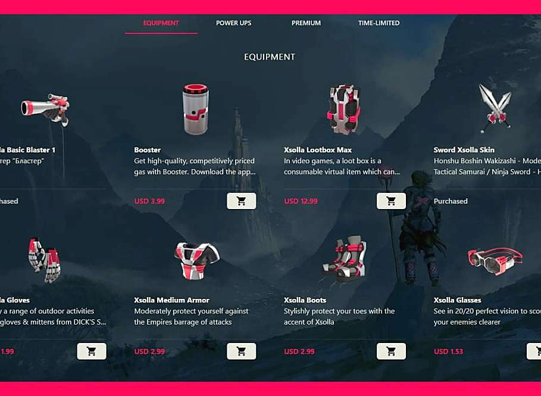

*리니지 본편 장면(p.11) / 리니지M 화면(p.12)*

**플랫폼이 금지한 거래가 국가 앞에서는 재산이 된다 (p.13)**

- 2001 서울고등법원: 게임 아이템을 형법상 '재산상 이익'으로 봄 — 속여 빼앗으면 재산을 빼앗은 것
- 2012 대법원: 게임머니를 부가가치세법상 '재화'로 판단, 중개업자 과세 처분 정당

**중국의 비트코인 — 사고파는 일은 막고, 훔치는 일은 처벌한다 (p.14)**

- 2021.9 10개 기관 공동 통지: 암호화폐 관련 모든 영업 활동을 불법 금융 활동으로 규정, 거래 계약은 법원 보호 X
- 2022 상하이 고급인민법원: 비트코인은 가치·희소성·처분 가능성을 갖춘 가상 재산 → 재산권 보호 확인
- 남의 지갑 복구 문구를 알아낸 피고인에게 징역 10년 9개월
- 2026.6 최고인민검찰원: 비트코인 절도 사건 107건을 모범 사례로 공개
- → 국가는 거래를 막지만, 훔치거나 속여 빼앗는 행위는 재산 범죄로 처벌

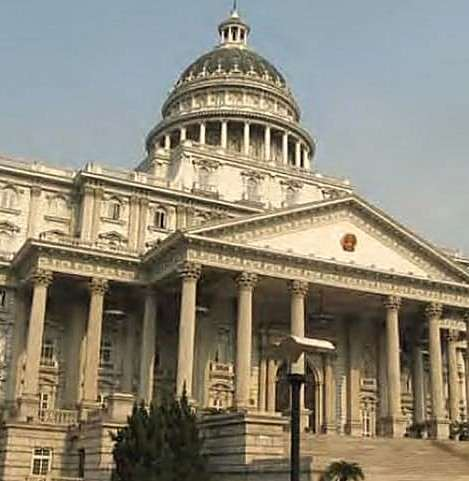

**거래가 금지되어도 빌린 것은 갚아야 한다 — 중학생과 담배 (p.16)**

- 학교에서 담배를 파는 중학생: 공법(학칙·청소년보호법)상 처벌 대상
- 그러나 돈을 떼먹으면, 거래 금지 여부와 별개로 산 사람이 갚아야 함
- '빌린 것은 갚아야 한다'는 감각은 거래 금지를 묻기보다 먼저 옴

### 1-4. 보통법의 계보

**노모스는 테시스보다 오래되었다 (p.17)**

- "공법은 로마 국가의 상태에 관한 것이고, 사법은 개인들의 이익에 관한 것이다." — 울피아누스(3세기), 『학설휘찬』
- 참고 도서: 하이에크 『법, 입법, 그리고 자유』, 헨리 메인 『고대법』, 브루노 레오니 『자유와 법』

**공법은 국경에서 멈추고, 사법의 직관은 국경을 넘는다 — 역외의 틈 (p.18)**

- 공법: 금지·과세·통제, 정한 나라 안에서만 작동
- 사법: 계약·채권·재산은 어디서나 같은 무게, 국가 명령으로도 취소되지 않음
- **런던은 그것을 팔았다**

**보통법은 왕의 법으로 태어났다 (p.19) / 왕의 법이 왕을 묶는 법이 되었다 (p.20)**

| 시기 | 사건 | 의미 |
|---|---|---|
| 12세기 | 헨리 2세, 왕의 판사 전국 순회 | 영주별 관습을 넘어 왕국 전체에 공통된('보통') 판결 적용 |
| 1215 | 마그나카르타 | 자유민은 적법한 판결·국법 없이 체포·재산 박탈되지 않음 |
| 13세기 | 브랙턴 | "왕은 법 아래 있다" |
| 1607 | 쿠크 대 제임스 1세 | 왕이라도 직접 재판할 수 없다 |
| 1628 | 쿠크 의회 연설 | 마그나카르타는 어떤 주권자도 용납하지 않는다 |
| 1701 | 왕위계승법 | 판사는 품행이 바른 한 왕의 뜻으로 해임될 수 없음 |

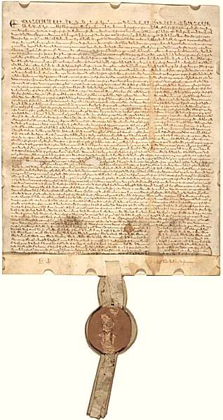

*헨리 2세 · 마그나카르타(p.19) / 에드워드 쿠크 · 제임스 1세 시대 법정(p.20)*

**대륙에서 사법은 입법이 되었다 (p.21)**

- 1804 나폴레옹 민법전: 국가가 사법의 질서를 한 권의 책으로 선포
- 판례가 쌓여 자라는 보통법 대신, 한 번의 제정으로 정해진 사법

**국적이 다른 사람들 사이에서 통하는 법 (p.22)**

- 기원전 242 로마 외인 담당 법무관
- 중세 상관습법(lex mercatoria)
- 중세 파이파우더 법정: '먼지 묻은 발'에서 온 이름, 장터 분쟁을 그날그날 해결
- 참고: 해럴드 J. 버만 『법과 혁명』(1983)

**절반은 외국인 배심 — 상인 헌장 (p.23)**

- 1303 에드워드 1세 상인 헌장: 외국인 배심의 절반, 통행과 거래의 자유
- 1353 스테이플 법: 양모 거래의 규율
- 1870 외국인 배심 폐지 — 수백 년 이어온 제도의 끝

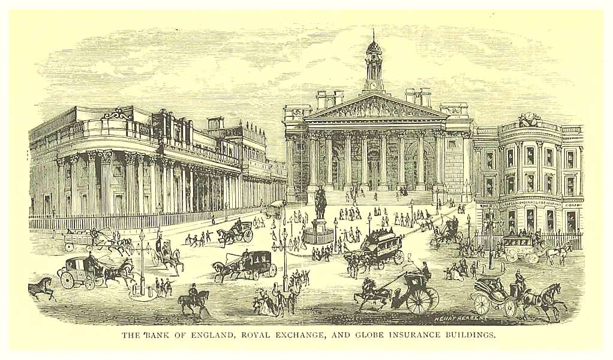

**상인은 정의로운 판결보다 예측할 수 있는 판결을 원한다 (p.24)**

- "모든 상거래에서 가장 중요한 목표는 확실성이어야 한다." — 맨스필드 경, 1774
- 1758 밀러 대 레이스: 도난당한 은행권도 선의의 취득자는 보호받음

**법이 국경을 넘어 상품이 되었다 (p.25)**

- 1892 런던 중재원: 법원 밖에서 상인 분쟁 해결
- 1895 상사법원: 고등법원 안에 상사 분쟁 전담
- 2019 카타리나 피스토어 『자본의 코드』: 글로벌 자본주의의 법은 사실상 둘뿐(영국법·뉴욕주법)
- ISDA 기본계약서는 영국법·뉴욕주법 중 선택 권고 → 거래가 영국과 무관해도 영국법 선택, **법은 상품이 됨**

**왜 비합리적이고 비체계적인 영국법일까? — 법의 기원 (p.26)**

- 라포르타·로페스데실라네스·슐라이퍼·비시니 「법과 금융」: 49개국 비교, 보통법 계통이 투자자·채권자를 강하게 보호하고 자본시장도 깊음
- 막스 베버의 '영국 문제': 덜 합리적이고 덜 체계적인 영국법에서 자본주의가 먼저 꽃핀 것은 수수께끼
- 체계의 합리성보다 상인에게 익숙한 점이 더 중요했을 가능성

### 1-5. 제국의 거미줄과 계약의 감각

**같은 법, 다른 세금 — 제국의 거미줄 (p.27)**

- 영국 왕실령: 저지, 건지, 맨섬 / 영국 해외 영토: 케이맨, 영국령 버진아일랜드
- 보통법이라는 공통 언어를 쓰면서 세금과 규제는 따로 정함

*건지 세인트피터포트 / 맨섬 더글러스 만 (p.27)*

**약속을 지키지 않은 도시 — 하멜른 (p.28) / 약속은 상대가 누구든 지켜야 한다 — 브라우닝 (p.29)**

- 1284 아이 130명의 기록 → 1300 무렵 교회 스테인드글라스 → 1559 짐머른 연대기에서 쥐가 등장
- "그들이 우리를 쥐에게서 구해 주든 생쥐에게서 구해 주든, 무언가 약속했다면 그 약속을 지키자!" — 로버트 브라우닝, 「하멜른의 피리 부는 사나이」(1842)
- 벌을 받는 쪽은 도시, 곧 공적 권력. 교훈은 신앙·충성이 아닌 **계약의 이행** → 왕의 법정이 왕을 묶은 보통법의 감각

**평판은 동맹 앞에서 멈췄다 (p.30)**

- 2022년 러시아 침공 뒤 런던이 앞장서서 올리가르히 자산 동결
- '정치와 금융은 별개'라는 평판은 영국이 미국의 동맹이라는 더 큰 사실 앞에서 한계를 드러냄

**같은 거미줄에서 다음 상품이 나왔다 — 반세기 뒤 (p.31)**

- 저지: 세계 최초의 규제형 비트코인 펀드
- 지브롤터: 세계 최초의 분산원장 사업자 면허

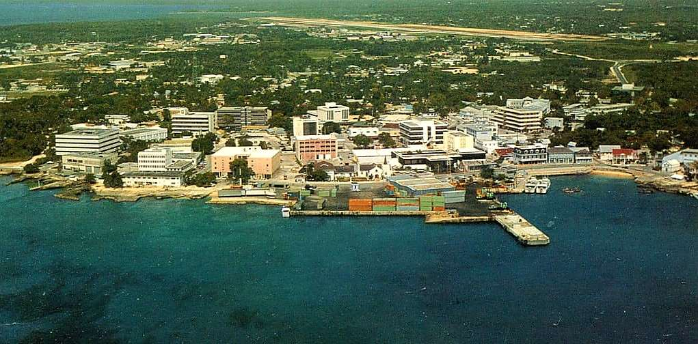

---

## Part 2. 섬들의 돌파구 — 유럽의 역외는 왜 크립토에 먼저 눈을 떴는가 (pp.32–59)

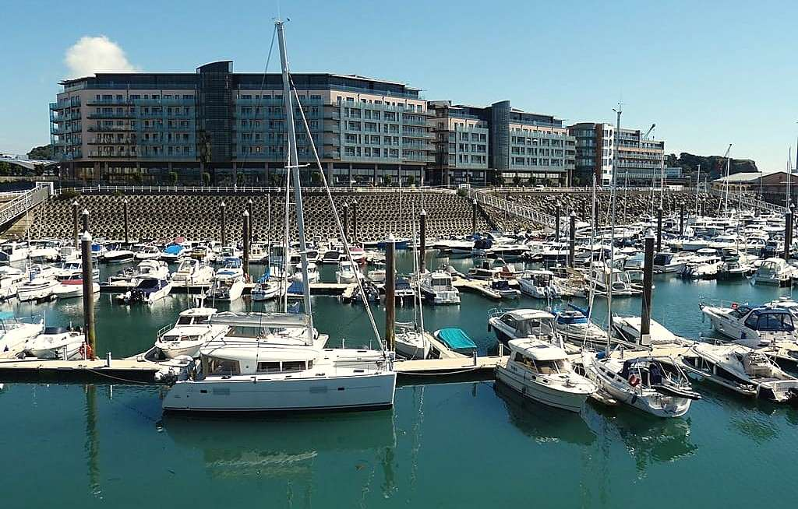
*세인트헬리어 마리나, 저지 (p.32)*

### 2-1. 비밀의 퇴출

**비밀의 퇴출과 다음 상품의 진열 — 두 개의 연대기 (p.33)**

| 연도 | 역외를 향한 압박 | 역외의 크립토 실험 |
|---|---|---|
| 2009 | UBS 기소유예 합의 · 7억8천만 달러 | 비트코인 첫 블록 |
| 2010 | FATCA 제정 | — |
| 2013 | 스위스 은행 프로그램 · 로크언 서약 | — |
| 2014 | CRS 채택 · 스위스 자동정보교환 수용 | 저지 펀드 · 추크 이더리움 · 오즈번 연설 |
| 2015 | — | 맨섬 AML 편입 · 영국 재무부 대응안 |
| 2016 | 파나마 페이퍼스 | 추크 비트코인 수납 · 룩셈부르크 비트스탬프 |
| 2017–18 | CRS 첫 교환 | 지브롤터 DLT, 몰타 3법, '크립토 국가' |
| 2019 | — | 리히텐슈타인 블록체인법 · UKJT 법률 성명 |

**미국의 묵인 — 냉전기 유럽 역외 (p.34)**

- 경제적 가치: 낮은 세율과 은행비밀이 이웃 대국의 납세자를 끌어들임
- 지정학적 가치: 중립의 금고와 유로달러 시장은 양 진영의 완충지대
- 미국의 묵인은 두 번째 가치(지정학)에서 나왔음

**완충지대가 필요 없어진 세계 — 임대의 종료 (p.35)**

- 1991 일극 세계: 중립의 금고는 장벽이 됨
- 2001 9·11: 테러자금 추적이라는 명분
- 2008 금융위기: 해외로 빠져나간 세원을 되찾아야 함
- 2009 UBS: 신호탄

**금고를 부순 것이 아니라 길을 막았다 (p.36)**

- UBS 금고 → 달러 결제망 → 미국 법무부
- Reuters 2009.2.18 "UBS to identify clients, pay $780 million in tax case" — 7억8천만 달러와 미국인 고객 정보 제출

**런던의 손으로 투명성에 서명하다 — 2013 왕실속령의 서명 (p.37)**

- 합의 1: 다자 간 자동 세무정보교환 시범사업
- 합의 2: 실소유자 정보 국가행동계획
- 합의 3: 조세 행정공조 다자협약
- 출처: GOV.UK 2013.5.20 "G8: PM writes to crown dependency leaders"

**금융은 글로벌 거버넌스, 혹은 제국주의화 되어 갔다 — 2014 무렵 (p.38)**

- 은행비밀 → FATCA·CRS로 무력화
- 저세율 → 글로벌 최저법인세로 무력화
- **섬들에게는 새 상품이 필요했다 — 압박할 중앙기관이 없는 화폐**

### 2-2. 영국과 섬들의 크립토 전략

**2014년, 재무장관이 디지털 화폐를 거론했다 (p.39)**

- "이 대안적 지급 체계들은 빠르고 싸고 편리해서 인기가 있다. 나는 이것들을 영국 경제를 위해 더 많이 활용할 수 있는지 보고 싶다." — 조지 오즈번, 이노베이트 파이낸스 출범 연설(2014.8.6)
- 재무부에 위험과 편익 검토 지시

**정권이 바뀌어도 언어는 바뀌지 않았다 (p.40)**

- 2014 조지 오즈번 — 디지털 화폐 검토
- 2022 리시 수낙 — "영국을 암호자산 기술의 글로벌 허브로 만드는 것이 나의 야망"(이노베이트 파이낸스 연설, 2022.4)
- 스테이블코인 규제 편입, 조폐국 NFT 발행. 반년 뒤 총리가 됨

**제3의 동산 — 법원과 의회 (p.41)**

- 2019.11 UKJT: 암호자산은 재산이 될 수 있다 (점유 가능한 물건도 채권도 아닌 제3의 동산)
- 2025.12.2 재산(디지털 자산 등)법 왕실 재가
- 2027.10.25 새 규제 시행

**서명한 섬이 1년 뒤 문을 열었다 — 저지 (p.42)**

- BBC News 2014.7.10 "Jersey approves first regulated Bitcoin fund"
- 부수석장관: "운용 중인 최초의 규제형 비트코인 펀드로 알려져 있다."

**등록증이 상품이 되었다 — 맨섬 · 지브롤터 (p.43)**

- 맨섬 2015: 범죄수익법 개정, 가상통화 사업자를 자금세탁방지 의무 대상에 편입
- 지브롤터 2018.1: 분산원장기술(DLT) 면허 — 세계 최초 자처
- 지브롤터 FATF 회색 목록: 2022.6 등재 → 2024.2 해제

**보통법, 크기, 그리고 반세기의 사업모델 — 왜 이 섬들이었나 (p.44)**

| 요인 | 설명 |
|---|---|
| 보통법 | 판례가 쌓이며 신탁과 새로운 형태의 재산을 받아들임. 성문법보다 빠르게 법이 자람 |
| 크기 | 입법자·감독자·업계가 같은 식당에서 점심을 먹음. 십만 명 안팎 인구, 작은 관할의 빠른 결정 |
| 사업모델 | 국경 밖의 돈을 받아 관리하는 일을 반세기 동안 해 옴. 비트코인은 이 셋이 맞물리는 첫 상품 |

→ 이 섬들은 작은 대국이 아니라 **작은 사업장**이었음

**법치와 중립을 팔다 — 스위스의 다음 상품 (p.45)**

- 2014.7 이더리움 재단 추크에 등기
- 2018.1 '크립토 국가' 스위스 선언
- 2018.2 FINMA ICO 지침 — 지급형·실용형·자산형 분류
- 스위스는 MiCA에 묶이지 않음, EU 패스포트도 없음

### 2-3. 몰타 — 블록체인 섬의 빛과 그늘

**하루에 세 개의 법을 통과시켰다 (p.46)** — 2018.7.4

- 몰타 디지털혁신청법: 국가 디지털 전환을 행정 전반에 붙이는 법
- 혁신기술 약정·서비스법: 혁신 영역을 시험하는 격리 구역과 사증
- 가상금융자산법: EU 회원국 안에서 처음 만든 포괄 면허 체계
- 그해 3월 바이낸스가 몰타 이전 발표

**몰타 총리가 화폐의 미래라고 말했다 (p.47)**

- "블록체인은 암호화폐를 피할 수 없는 화폐의 미래로 만든다." — 조지프 무스카트, 유엔총회 연설(2018.9)
- 회원국 정상이 유엔 연단에서 암호화폐를 화폐의 미래로 선언한 첫 사례

**섬은 감시망 밖에 설 수 없다 (p.48)**

- 2017.10 카루아나 갈리치아(언론인) 살해
- 2020.1 무스카트 총리 사임
- 2020 감독청, 바이낸스 인가 부재 공지
- 2021.6 FATF 회색 목록 등재(Reuters 2021.6.25) → 2022.6 해제

**인구 50만의 나라가 프랑스와 같아졌다 — 2026, 다시 관문 (p.49)**

- MiCA 인가 사업자 210개(EU 27개국 통합) / 몰타 비중 6% 안팎(회원국 중 가장 큰 점유율) / 인구 50만(회원국 평균 1%도 안 되는 규모) — 2026년 6월 기준
- OKX·크립토닷컴이 몰타 인가로 EU 패스포트 획득

### 2-4. 브렉시트와 MiCA

**거미줄이 두 갈래로 갈라졌다 — 브렉시트 (p.50)**

| EU 밖 | EU 안 |
|---|---|
| 영국 · 저지 · 건지 · 맨섬 · 지브롤터 | 몰타 · 키프로스 · 아일랜드 · 룩셈부르크 |
| MiCA 미적용 · EU 패스포트 없음 | 영국법 유산을 머금은 단일시장 안 |

- 영국이 떠나자 자유주의 진영의 가장 큰 목소리가 사라지고 작은 관할들만 남음

**규칙은 하나, 문제는 넷 — MiCA, 브뤼셀의 단일한 시선 (p.51)**

1. 패스포트의 역설 — 규칙은 하나, 심판은 27명
2. 스테이블코인과 통화주권 — 달러화를 막는 둑
3. 다중 발행 — 중앙은행과 의회가 다른 곳을 봄
4. 규제의 빈자리 — 발행자 없는 비트코인, 중개자 없는 DeFi

**달러 스테이블코인을 막는 둑 (p.52)**

- 거래소의 단계적 차단: 2024년 말 코인베이스 유럽 USDT 상장 폐지 → 2025.3.31 바이낸스 EEA 이용자 9개 스테이블코인 거래 중단
- 유로 외 통화 스테이블코인 발행·결제 상한: 1일 100만 건 · 2억 유로, 초과 시 거래 제한(MiCA 제23조)
- 테더는 EU 인가를 받지 않음 — 결제 영역의 통화는 유로가 지켜야 한다는 계산

**문은 열렸지만 통과자는 줄었다 (p.53)** — 2026.7.1 경과기간 종료, 대형 사업자 인가지 합계 14곳

| 국가 | 곳 |
|---|---|
| 독일 | 4 (약 1/4) |
| 네덜란드 | 3 |
| 룩셈부르크 | 2 |
| 몰타 | 2 |
| 그 외 회원국 | 3 |

- 제미니 철수, 바이낸스 불투명. 코인베이스 룩셈부르크, 크라켄 아일랜드, 바이비트 오스트리아, OKX·크립토닷컴 몰타

**필요한 것은 중앙화가 아니라 수렴 — 발레타의 반론 (p.54)**

- "값비싸고 비효율적인 중앙집권 모델보다 감독의 수렴을 추구해야 한다." — 질 로트, 룩셈부르크 재무장관
- "구조적 변화를 도입하는 것은 시기상조." — 몰타 금융감독청
- 보충성 원칙. 1990년대 저축과세지침 때와 같은 진영

### 2-5. 대서양의 역전

**달러가 크립토를 삼키다 (p.55)**

- 2025.1.23 CBDC 추진 금지 행정명령
- 2025.3.6 전략 비트코인 비축
- 2025.7.18 지니어스법 서명

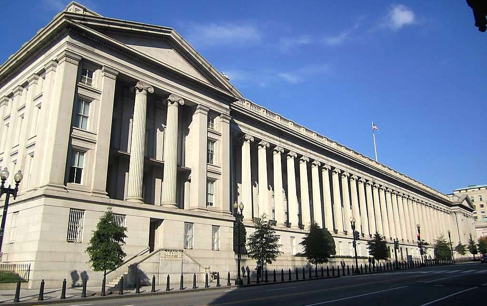

**달러의 새로운 모세혈관 — 지니어스법 (p.56)**

- 스테이블코인 발행자 → 준비금 적립 → 미국 국채 준비금
- 법 집행 요구 → 주소 동결
- 압박할 중앙기관이 없던 세계에 **발행자라는 중앙기관**이 다시 들어섬. 그 발행자는 미국 법의 관할 안에 있음

**혁신의 틀이 둑으로 바뀌었다 — 유럽의 응답 (p.57)**

- 2022 세계 최초의 포괄적 암호자산법(MiCA)
- 2025 이후 스테이블코인 조항 — 달러화를 막는 둑
- 디지털 유로를 서두르는 것도, 다중 발행을 막자는 것도 같은 이유

**틈은 세 번 좁아졌다 (p.58)**

| 시기 | 역외의 위치 |
|---|---|
| 냉전 | 미국과 소련 사이 |
| 냉전 이후 | 가시성 압박과 세원 회수 사이 |
| 지금 | 달러 스테이블코인과 단일 감독 사이 |

- 몰타·룩셈부르크·키프로스가 지키려는 감독주권은 마지막 틈

**맺음 (p.59)**
> 유럽은 아직 하나의 주권체가 아니다. 그리고 국가의 시선이 하나로 합쳐지지 않는 한, 그 틈에서 다음 상품을 찾는 섬들은 계속 나타날 것이다.

---

## Part 3. 배관의 장악 — FIFA 사건과 유로달러의 결제 구조 (pp.60–74)

### 3-1. FIFA 사건: 미국 밖의 범죄, 뉴욕의 법정

**그들을 기소한 것은 스위스가 아니었다 (p.60)** — 2015년 5월 27일, 취리히 바우어 오 락

- 이튿날 FIFA 총회에 참석하러 모인 축구 행정 거물들이 스위스 경찰에 의해 호텔 객실에서 체포됨
- 기소 14명: 임원 9명 + 스포츠 마케팅·중계권 사업가 5명
- 혐의: 공갈조직 운영 공모(RICO), 전신사기, 자금세탁. 적시된 뇌물·리베이트는 24년간 1억 5천만 달러 초과
- 기소한 것은 스위스가 아니라 **바다 건너 미국**

**FIFA, 새벽의 체포 (p.61)**

- "The indictment alleges corruption that is rampant, systemic and deep-rooted — both abroad and here in the United States." — 로레타 린치 법무장관

| 항목 | 수치 |
|---|---|
| 체포 | 7명 |
| 기소 | 14명 |
| 혐의 | 47개 (RICO·전신사기·자금세탁, 20년에 걸친 행위) |
| 2016 코파 아메리카 센테나리오 관련 공모 뇌물 추정치 | 1억 1,000만 달러 (정당한 권리 비용의 약 1/3) |
| 협력 피고 몰수 동의액 | 1억 5,000만 달러 초과 |

- 체포된 이들 대부분은 미국인이 아니었고 뇌물도 대부분 미국 밖에서 오갔음. 그런데 법정은 뉴욕에 있었음

**25만 달러짜리 수표의 무게 — FIFA 관할의 세 고리 (p.62)**

| 고리 | 내용 |
|---|---|
| ① 지급 통화 — 달러 | 뇌물 일부가 미국 달러로 지급됨. 통화 선택이 배선 위치를 결정 |
| ② 배선 위치 — 환거래망 | 그 달러가 미국 은행 환거래망(코레스 계좌·CHIPS·Fedwire)을 경유 |
| ③ 모의 장소 — 통신선·출장 | 관련자 일부가 미국을 오가거나 미국 통신망 이용 |

- 카리브해 은행 대리인이 뉴욕에서 25만 달러 수표를 받아간 사실 하나가 관할의 고리가 됨
- 세계 축구의 부패를 심판한 법정은 축구장이 아니라 뉴욕에 있었음

**그런데 왜 미국 법정에 서야 하는가 (p.63)**

- 사람(비미국인), 장소(스위스·중남미·제3국), 이권(월드컵·대륙컵 중계권) 모두 미국 것이 아님
- 러시아 등 여러 나라 반발: "법적 제국주의", 주권 침해 (2018 월드컵 개최국 러시아의 입장)
- 이 장의 물음: **미국이 실제로 쥐고 있던 것은 무엇인가**

**미국이 쥔 것은 영토가 아니라 배관이었다 — 뉴욕 동부지검(EDNY)의 논리 (p.64)**

- 뇌물이 어디서 출발했든, 상당 부분이 미국 내 은행 환거래 계좌에서 청산(clearing)되고 미국 경유 전신망을 탐
- 기소장: 자금을 'in and through the United States' 이동 → 미국 금융 시스템을 범죄 도구로 쓴 미국 내 연방 범죄
- 미국은 외국에 경찰을 보내지 않음(체포는 스위스 경찰, 미국은 송환 요청만)
- 미국이 쥔 것 = **달러라는, 전 지구를 순환하는 피가 흐르는 배관의 밸브** → 담장을 넘지 않고도 사실상 '글로벌 치안조직'으로 행세

### 3-2. 달러는 왜 뉴욕을 지나는가

**세계 모든 달러 거래는 뉴욕을 스쳐 지나간다 (p.65)**

- 브레튼우즈 이후 달러가 기축통화: 무역 대금, 원유 결제, 각국 중앙은행 준비자산
- 달러의 최종 결제 수단은 연준 예치 준비금이고, 연준 계좌는 미국 안의 은행만 가질 수 있음
- → 미국은 배관을 통과하는 모든 것을 들여다보고, 필요하면 잠글 수 있는 위치

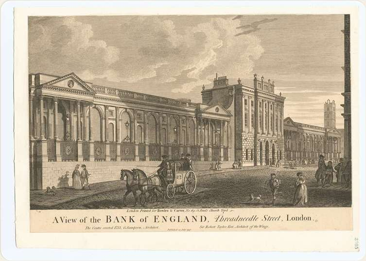
*영란은행 고판화 — 런던에서 자란 유로달러 시장의 무대 (p.65)*

**미국은 글로벌 금융의 배관을 확보하고 있다 (p.66)**

- "글로벌 데이터는 미국 버지니아 주를 경유한다"
- 배관을 무기로 쓸 때서야 전 세계는 미국이 모든 금융 데이터를 들여다보는 현실을 인지
- 참고 도서: Henry Farrell · Abraham Newman, 『Underground Empire: How America Weaponized the World Economy』

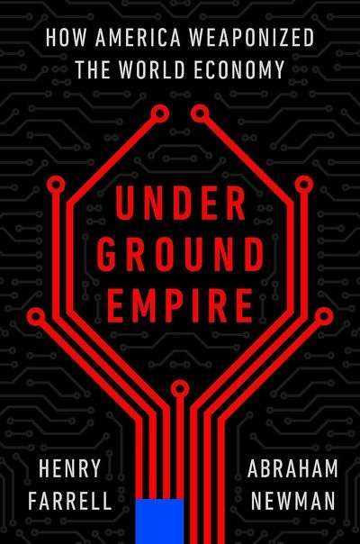

**돈은 바다를 건너지 않는다 — 장부만 움직인다 (p.67)**

- 싱가포르 은행이 두바이 은행에 달러를 보낼 때: 두 은행이 미국 은행에 열어 둔 환거래 계좌(correspondent account) 사이의 장부상 이동일 뿐
- 최종 확정은 CHIPS·페드와이어(Fedwire) 등 미국 내 청산체계
- "태평양과 인도양을 건너는 돈은 없다. 계좌와 계좌 사이의 한 줄이 바뀔 뿐이다."

### 3-3. T계정으로 본 유로달러 (단위: 만 달러)

**표 1. 유로달러의 창출 (p.68)** — 기업이 뉴욕 예금 1,000만 달러를 런던 L은행 달러 계좌로 옮길 때

| 기관 | 자산 | 부채 |
|---|---|---|
| 기업 | 체이스 예금 −1,000 / 런던L 예금 +1,000 | — |
| 체이스(뉴욕) | 연준 준비금 −1,000 | 기업 예금 −1,000 |
| 시티(뉴욕) | 연준 준비금 +1,000 | L은행 예금 +1,000 |
| 런던 L은행 | 시티 예금 +1,000 | 유로달러 예금 +1,000 |
| 연준 | 불변 | 체이스 −1,000 / 시티 +1,000 (합계 0) |

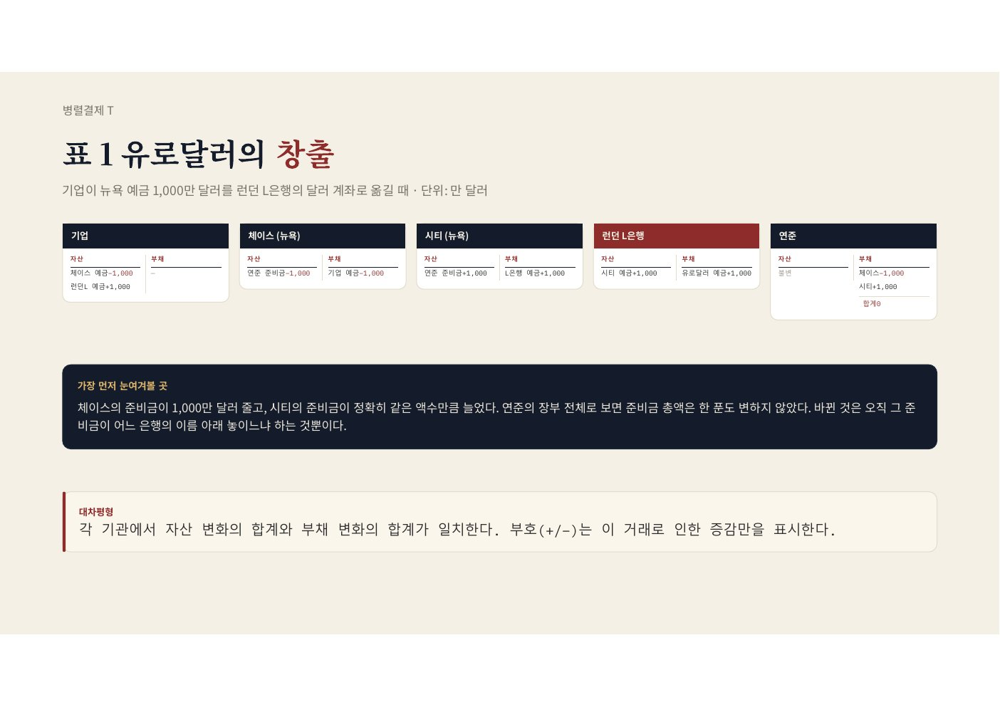

**런던의 달러는 런던에 있지 않다 — 표 1을 읽는 법 (p.69)**

- 연준 준비금 총액은 불변, 바뀐 것은 준비금이 어느 은행 명의에 있느냐뿐
- 런던 L은행의 유로달러 예금 1,000만 달러 배후에는 뉴욕 시티은행 예금 1,000만 달러가 그대로 대응
- 런던의 달러는 **뉴욕에 있는 달러에 대한 청구권**일 뿐. 창출 순간에도 달러는 나라 밖으로 한 걸음도 나가지 않음

**표 2. 유로달러의 이전 (p.70)** — 런던 두 은행 고객 간 지급 (A은행↔체이스, B은행↔시티)

| 기관 | 자산 | 부채 |
|---|---|---|
| 런던 A은행 | 체이스 예금 −1,000 | A고객 예금 −1,000 |
| 런던 B은행 | 시티 예금 +1,000 | B고객 예금 +1,000 |
| 체이스(뉴욕) | 연준 준비금 −1,000 | A은행 예금 −1,000 |
| 시티(뉴욕) | 연준 준비금 +1,000 | B은행 예금 +1,000 |
| 연준 | 불변 | 체이스 −1,000 / 시티 +1,000 (합계 0) |

- 런던 은행들은 연준 계좌가 없으므로 뉴욕 환거래 은행이 대신 결제 → 런던의 지급이 실제로는 뉴욕의 체이스–시티 결제로 완결

**병렬 결제 — 두 개의 장부, 하나의 사실 (p.71)**

- 페리 멀링(Perry Mehrling)의 용어 'parallel settlement': 지급 지시(런던)와 청산(뉴욕)이 나란히, 동시에 일어남
- 미국 쪽 다리는 반드시 CHIPS·페드와이어 통과
- **역외 달러의 모든 지급은 결국 뉴욕의 장부 위에서 완결된다**

**표 3. 연준의 장부 — 명의만 이동한다 (p.72)**

| 연준 | 자산 | 부채(은행 준비금) |
|---|---|---|
| 변화 | 없음 (0) | 체이스 −1,000 / 시티 +1,000 / 합계 0 |

- 결론: **국경을 넘은 달러는 없다.** 바뀐 것은 뉴욕에 있는 같은 달러의 장부상 명의뿐

**유로달러의 원천은 부기 담당자의 펜이다 (p.73)**

- "유로달러의 진정한 원천은 '부기 담당자의 펜(a bookkeeper's pen)'이다." — 밀턴 프리드먼(1971)
- 런던 L은행은 받은 유로달러를 다시 빌려주고, 그 대출이 또 다른 유로달러 예금을 낳음 → 미국 밖에서 신용이 몇 겹으로 불어나는 피라미드
- 그러나 맨 밑바닥엔 언제나 미국 은행의 진짜 예금. 역외 달러는 **뉴욕에 뿌리를 박은 채 이름표만 해외에 걸어 둔 돈**

**글로벌 중앙 장부를 비켜 가려는 야망 (p.74)**

- 러시아의 '법적 제국주의' 항변은 단순한 항변이 아니라 예고
- 세 가지 우회 시도: ① 자국 통화 결제망 ② 위안화 국제화 ③ 장부의 분산(기술적 시도)
- 모두 '뉴욕을 지나지 않는 달러 아닌 돈'을 만들려는 노력
- 역설: **배관을 통제에 사용할수록, 중앙 장부를 비켜 가려는 야망도 강해진다**

---

## Part 4. 구조적 권력과 달러 스테이블코인 — "미국 쇠퇴론은 과장되었다" (pp.75–106)

**장 표지 (p.75)** — 일본대망론의 한복판에서: 유로달러와 중심·주변부의 비대칭

- 1960년대 유로달러에 대한 수잔 스트레인지(1923–1998, 구조적 권력론)의 분석은 2026년 미국의 크립토 제도화를 그대로 설명함
- 『로컬국가의 후퇴가 곧 시장 — 미국제 시장 — 의 전진이 된다.』

### 4-1. 패권의 조건과 소진

**GDP 반토막 — 수행자가 소진되는 궤적 (p.76)**

- 미국의 세계 GDP 비중: 1945 약 50% → 1960 약 40% → 2019 약 24% (59년 동안 절반으로)
- 한국전·베트남전이 재정과 국제수지를 잠식
- 1971.8.15 닉슨 금태환 정지 → 브레튼우즈 붕괴
- 결산: 압도적 우위가 줄면 퓨상스(puissance, 존재만으로 이끄는 힘)는 포스(force, 청구서)로 갈라짐 — 그 이행 자체가 소진의 서명

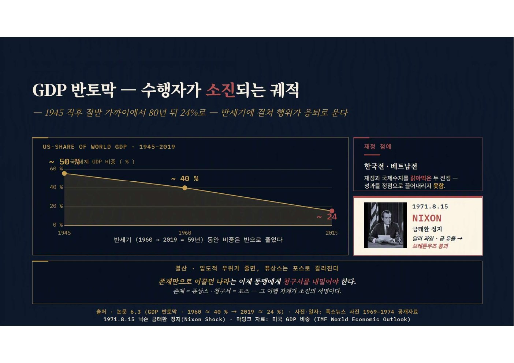

**스트레인지의 구조적 권력 4요소 (p.77–78)**

| 구조 | 결정하는 것 | 상태 |
|---|---|---|
| SECURITY(안보) | 누가 누구를 보호하는가 | Held |
| PRODUCTION(생산) | 무엇이 만들어지는가 | Held |
| FINANCE(금융) | 누가 신용을 창조하는가 | Held |
| KNOWLEDGE(지식) | 무엇이 참으로 인정되는가 | Held |

- "One alternative is buildable. Four are not." (Strange 1988) — 하나의 대안은 만들 수 있어도 넷을 동시에 대체할 수는 없음
- "Four assets. The bill is paid by a fifth."

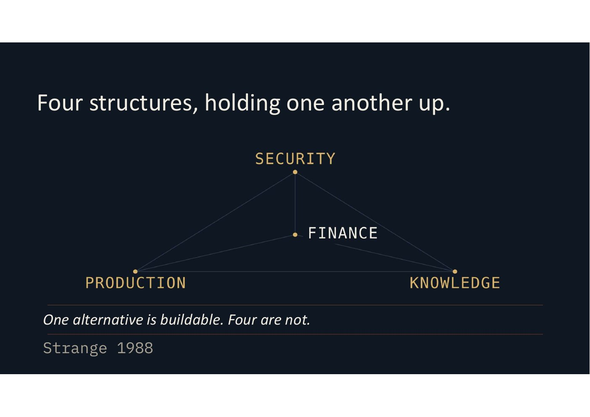

### 4-2. 데이터로 본 달러 스테이블코인

**핵심 성장 지표 (p.79)** — 2026년 8월 기준

| 지표 | 값 | 비고 |
|---|---|---|
| 시가총액 | $305bn | 2년간 약 1.9배 |
| USD 표시 비중 | 99% | 전체 스테이블코인 중 |
| 상위 2종(USDT+USDC) 점유율 | 85% | 1년 새 90%에서 하락 |
| 연간 거래대금(2025) | $33tn | 전년 대비 72% 증가 |

출처: DefiLlama(2026.8.22), Bloomberg(2026.1), CoinLaw(2026.6)

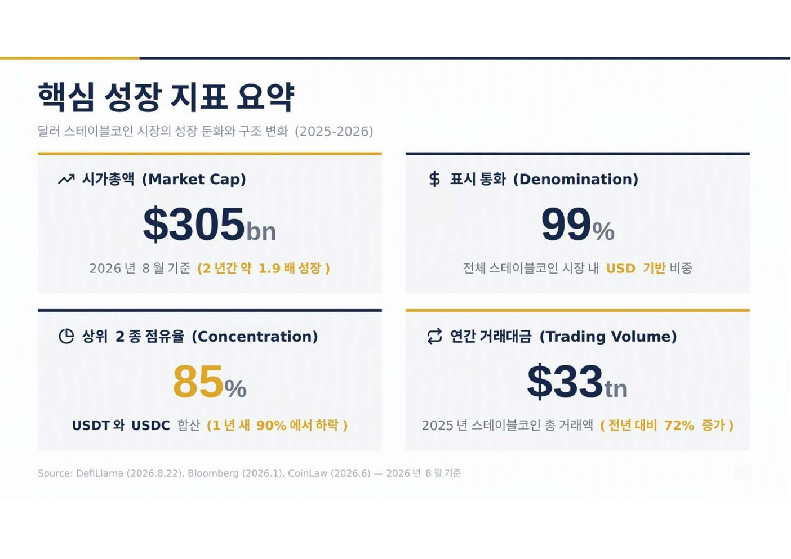

**시가총액과 국경간 흐름 비교, 2024 (p.80)** — IMF(2025) *Understanding Stablecoins*, Fig.4

- 스테이블코인은 시가총액 비중이 약 7%지만 국경간 흐름은 약 1.5조 달러로 BTC·ETH 국경간 송금액을 모두 상회
- Chainalysis와 Reuter(2025)의 측정 범위는 다르나 두 지표 모두 스테이블코인 우위

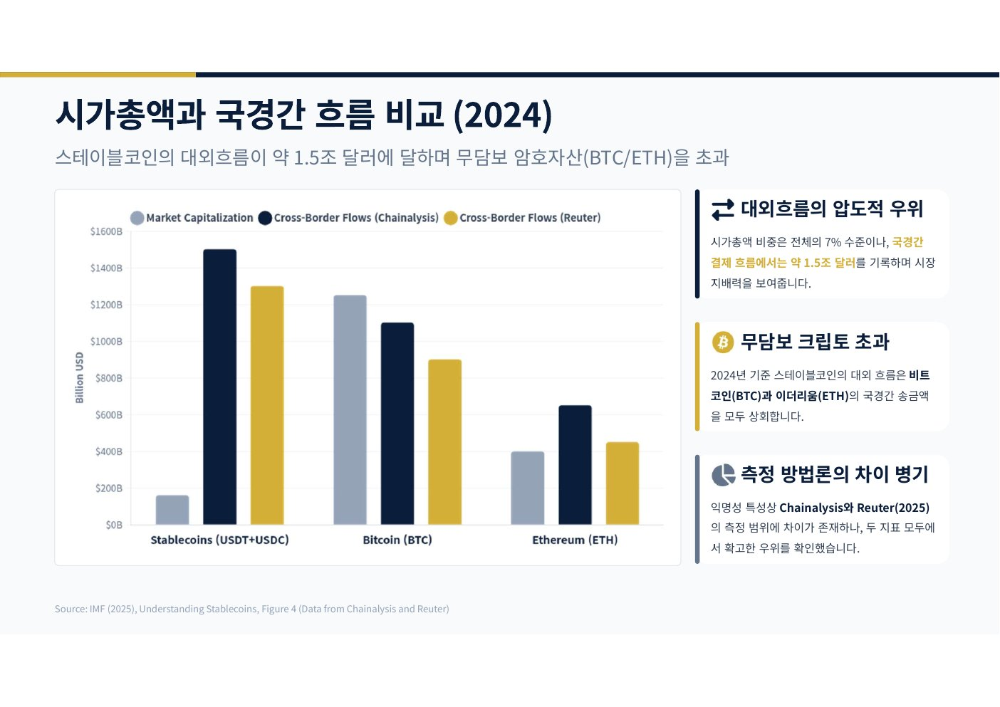

**글로벌 경제·통화 구도, 2023 (p.81)** — IMF(2025) Fig.6 재구성

| 지표 | 미국/달러 비중 |
|---|---|
| 글로벌 GDP | 25.4% |
| 외환보유고 | 58.9% |
| 국제결제(SWIFT) | 84.3% |
| 스테이블코인 USD 페깅 | 97% |

- 실물 경제 비중(약 25%)에 비해 금융·결제에서 달러가 과대대표되며, 이 패권이 온체인으로 확장

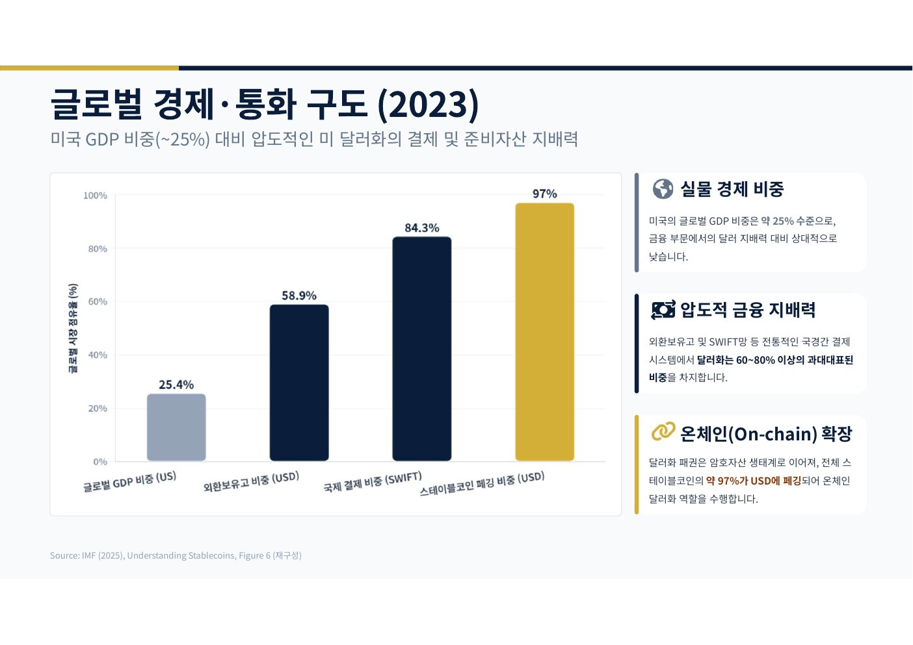

**지역별 스테이블코인 활용 (p.82)**

- 절대 규모: 아시아·태평양 1위, 북미 2위
- GDP 대비 비중: 아프리카·중동, 중남미가 두드러짐
- 순 흐름: 북미 → 타 지역 유출이 압도적 (가치 저장·국경간 결제 수요 반영)

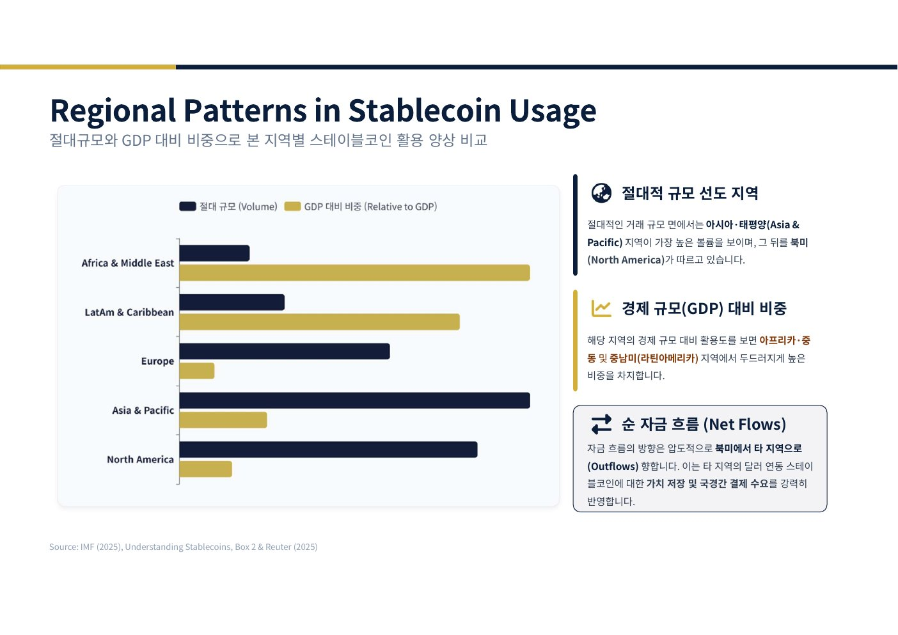

**결제 코리도와 신흥·개도국(EMDE) (p.83)**

| 구분 | 선진국 간 | 선진국–신흥국 | 신흥국 간 |
|---|---|---|---|
| 전통 국경간 결제(SWIFT) | 75% | 15% | 10% |
| 스테이블코인 결제 | 20% | 35% | 45% |

- 고인플레이션·통화 불신 국가에서 달러 스테이블코인이 가치 저장·결제 수단으로 자리잡음 → 비공식 달러라이제이션으로 거시정책 유효성 저해 가능

**달러 스테이블코인, 거래용 돈에서 금융의 돈으로 (p.84)**

- 용도 확장: TRADE(거래소 대기자금) → SAVE(달러 저축) → SEND(해외 송금) → PAY(결제) → **FINANCE(담보·대출·정산)**
- "통화가 불안한 나라일수록 달러 코인을 쓴다"

| 국가 | BTC | ETH | 알트코인 | 스테이블코인 |
|---|---|---|---|---|
| 아르헨티나 | 14.7% | 10.0% | 13.4% | **61.8%** |
| 브라질 | 14.2% | 12.1% | 13.8% | 59.8% |
| 콜롬비아 | 13.7% | 8.8% | 11.5% | 66.0% |
| 멕시코 | 19.3% | 16.6% | 17.0% | 47.2% |
| 베네수엘라 | 12.2% | 15.9% | 15.4% | 56.4% |
| 글로벌 평균 | 22.3% | 8.3% | 24.6% | 44.7% |

*국가별 소액 암호화폐 거래 중 자산 비중*

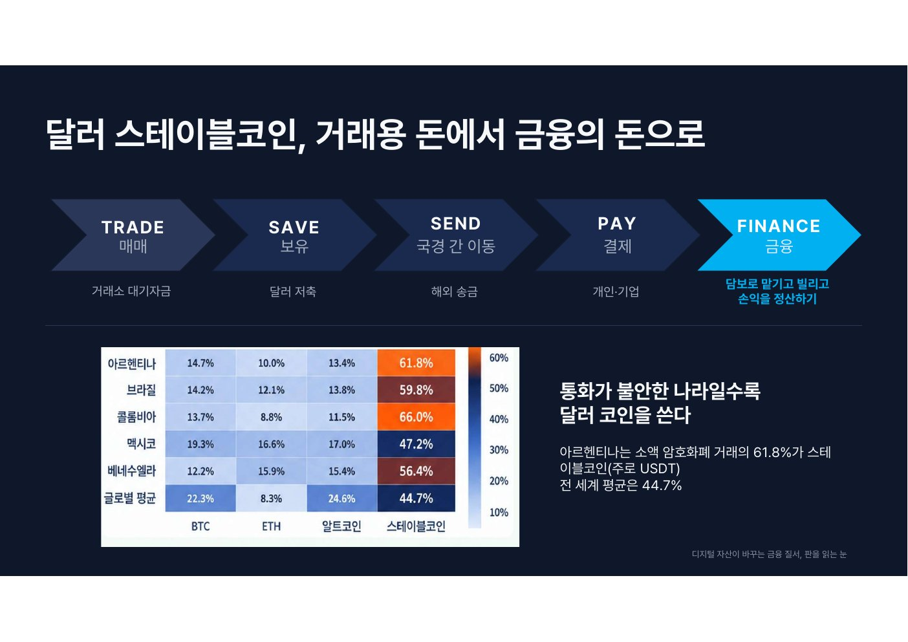

**불가능한 삼위일체와 통화주권 침식 (p.85)**

- 먼델의 삼위일체: 환율 안정·통화정책 재량·자본 개방 중 2가지만 가능
- 스테이블코인 침투 영향: 통화량 통제 무력화, 금리 정책 효과 감소, 환율 조작 능력 상실
- 핵심: 스테이블코인의 침투가 삼위일체를 재해석하게 만듦 (스테이블코인 시장 $150B+, 2025)

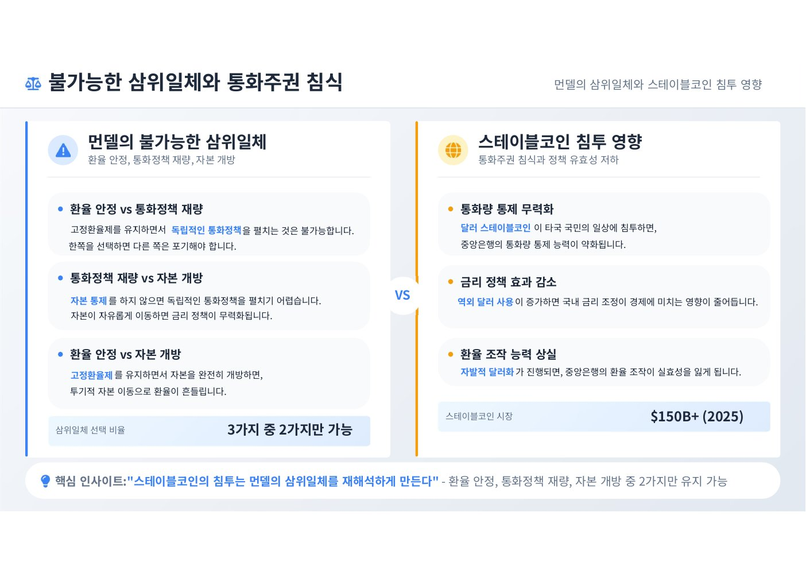

### 4-3. 60년 전 장부와 같은 결산

**1960년대 유로달러 vs 2026 스테이블코인 제도화 (p.86–87)** — 로컬 국가(▼ 약화) / 미국(▲ 유지·확장)

| 항목 | 1960년대 로컬 국가 ▼ | 1960년대 미국 ▲ | 2026 로컬 국가 ▼ | 2026 미국 ▲ |
|---|---|---|---|---|
| ① 자본통제 담장 | 유로달러가 장부 밖으로 달러를 옮기며 우회 | 규제 바깥 그림자 세계 허용 | 스마트폰 지갑으로 우회, 자본계정 아래부터 사실상 개방 | 발행자·거래소 관문은 미국 관할 |
| ② 레귤레이션 Q·이자평형세 / 이자율 주권 | 은행이 역외로 이주, 규제 공동화 | 베트남전 과잉 달러의 잔류 허용 | '자본 개방' 강제 점등 → 환율 방어에 금리 종속 | 달러 금리 = 세계의 기준금리 |
| ③ 금태환 청구 / 가시성·집행 | 역외 잔류로 부담 전가 | 금 청구권 대신 세계가 떠안는 신용 | 자국 금융정보기구가 토큰 흐름을 못 읽음 | 온체인 분석 + 발행자 동결 스위치(테더 2025 동결 ≈ 12.6억 USD) |
| ④ 신용 창조권 / 국채 수요 | 유로은행 몫, 시장으로 권력 이동 | 용인만으로 구조의 중심 유지 | 국채 수요 조성 능력 상실 | GENIUS법 100% 준비금(현금+단기 국채), 2025.7.18 서명·2027.1.18 효력 |

- 결산: **국가의 후퇴(▼) = 미국의 전진(▲)** — 60년 전 장부와 같은 결선
- 테더 미 국채 보유 ≈ 1,400억(국가 보유자 대비 17위), 스테이블코인 총 시총 ≈ 3,080억(2026.8, DefiLlama), 테더 2024 순매입 세계 7위권

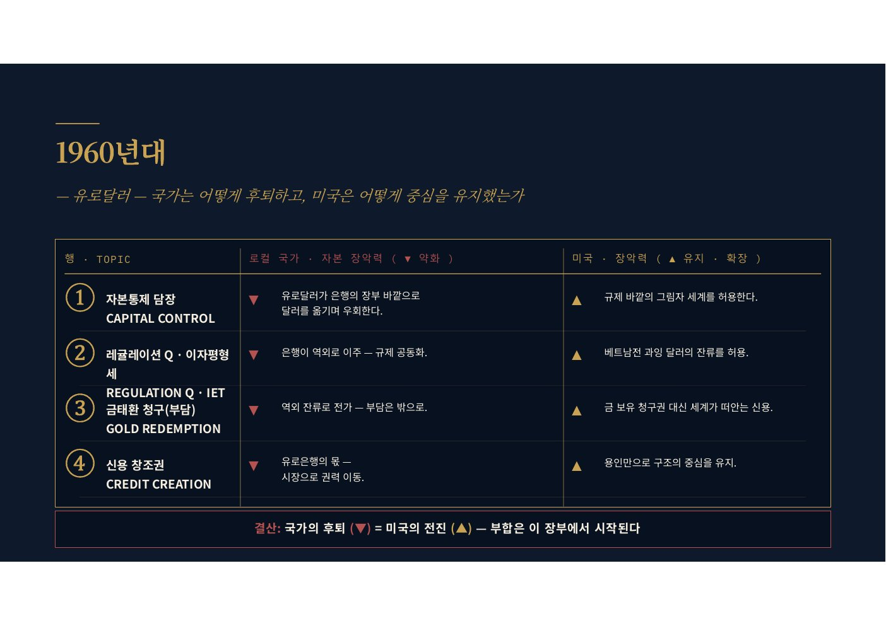
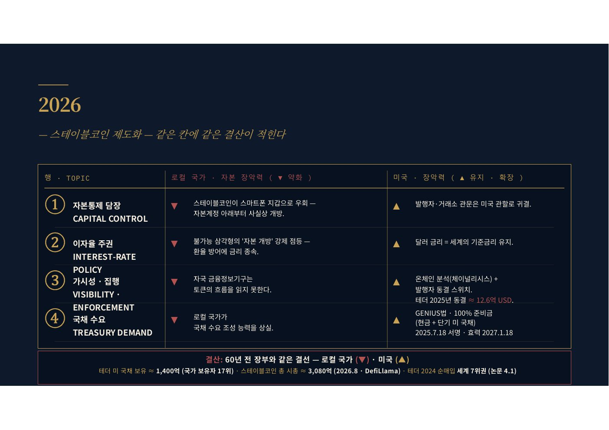

### 4-4. 세 개의 의도 — 한 인프라로 수렴

**세 개의 의도 (p.88)**

| 의도 | 핵심 기제 | 상징 수치 |
|---|---|---|
| 01 부채(국채 수요) | GENIUS Act가 준비금을 현금+단기 국채로 묶어, 스테이블코인 확산 = 미 국채 수요 증가 | ≈ 13조 USD (유로달러 규모, "온체인으로 이식된 유로달러") |
| 02 디지털 영토 | SWIFT는 계좌, 지폐는 운반·보관이 필요하지만 스테이블코인은 스마트폰만으로 국경 허가 없이 보유·이동 | ≈ 99% (온체인 스테이블코인의 달러 연동) |
| 03 지정학 | 선택의 자유도가 높을수록 달러 지배력은 커짐 (외환보유고 59% · 결제 84% · 자유 선택 97~99%) | 97~99% ("진짜 저수지는 시민의 자발적 선호") |

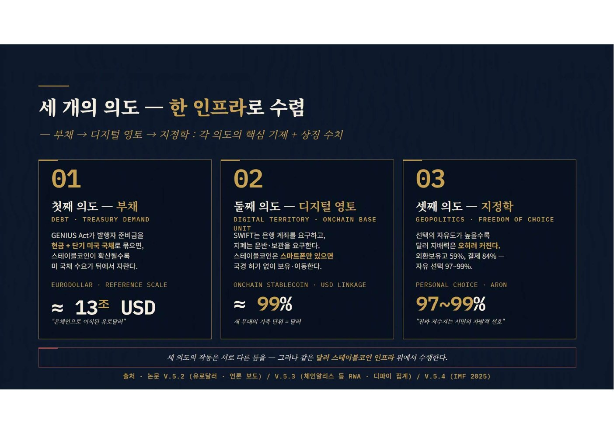

**첫째 의도 — 국채 수요의 지지와 확장 (p.89)**

- 인과 사슬: 라고스 상인·부에노스아이레스 가정의 USDT/USDC 수요 → 발행자 준비금(현금+단기 국채) → 미 국채 수요 → 미국 부채의 소매 유통망
- 테더: 2024 세계 미 국채 순매입 7위권(보도)
- "외국인이 스마트폰에서 디지털 달러를 선택할 때 — 미국 국채 수요가 뒤에서 따라온다."

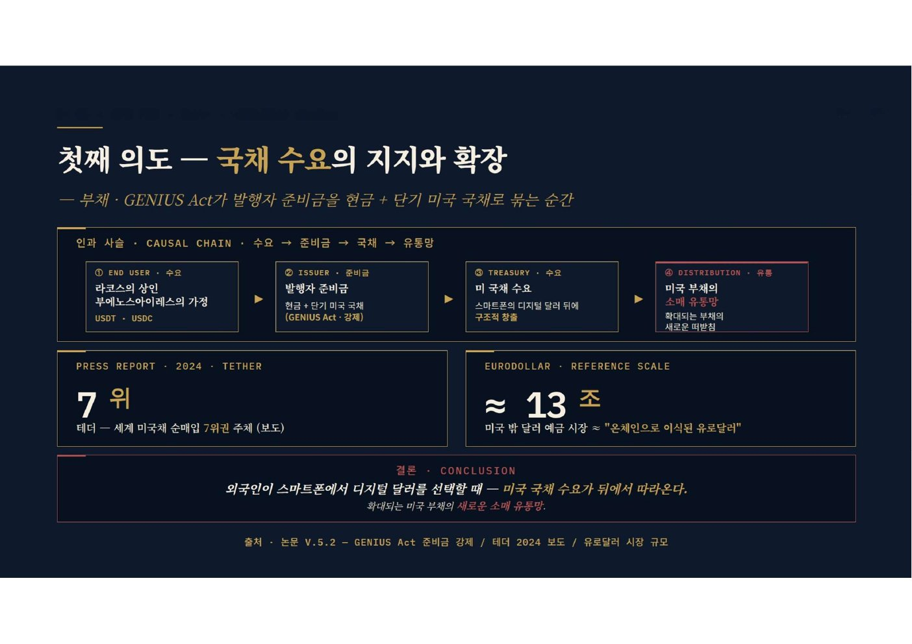

**둘째 의도 ① — 새 무대의 선점 (p.90)**

- 옛 무대의 한계: SWIFT(은행 계좌 필요), 지폐(운반·보관 필요), 무계좌 성인 약 14억 명
- 새 무대: 스마트폰만으로 보유·이동, 은행 계좌 불요, 국경 허가 불요 — 온체인 스테이블코인의 약 99%가 달러 연동

**둘째 의도 ② — 온체인 금융의 달러 수렴 (p.91)**

- RWA 토큰화: 60억 → 314억(2025 초 → 2026.5, 16개월 5배+), 토큰화 미 국채 약 68억, 블랙록 BUIDL 25억+
- 탈중앙 무기한선물(하이퍼리퀴드, 2025): 연 거래액 약 2조 9,500억 USD, 증거금·정산 = USDC
- 예측시장(폴리마켓, 2025): ICE 투자 20억 / 기업가치 90억, 베팅·지급 = USDC
- "20세기 달러 = 석유의 표시 통화 → 21세기 달러 = 온체인 자산 전체의 표시·정산 통화"
- ※ 슬라이드에 대부분 통화 단위 표기 없음(원문 그대로)

**가시성은 사라지지 않고 — 이동한다 (p.92)**

- 로컬 정부: 은행을 우회한 토큰은 금융정보기구(FIU) 보고망 밖 → 시야 없음
- 공개 블록체인: 영구 기록
- 워싱턴: 공개 원장 + 발행사 관할 → 시야 있음
- 명제: **가시성은 사라지는 것이 아니라 이동한다**

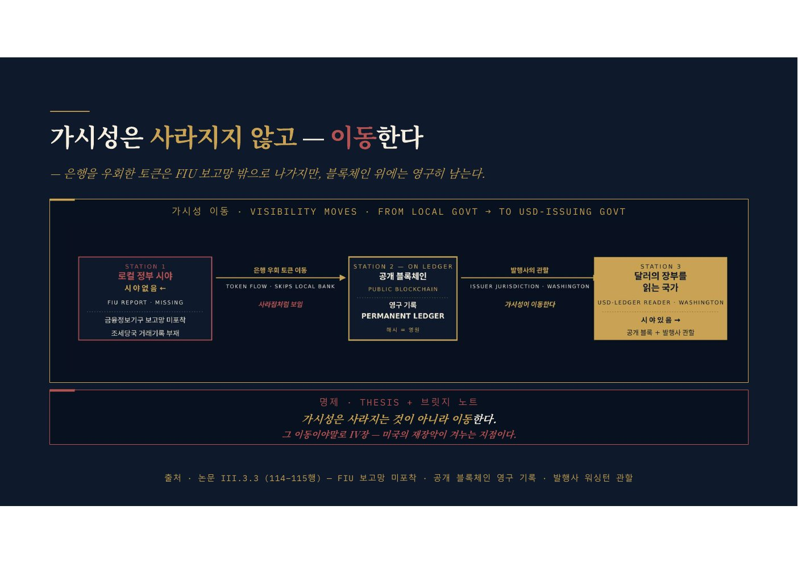

**선택의 메뉴가 사라진 중앙은행들 — 세 줄 요약 (p.93)**

1. 메뉴 붕괴: 탈은행 화폐가 삼각형의 한 꼭짓점(자본 개방)을 기정사실화 → 남은 선택지는 하나
2. 나선·주권 반납: 약세 → 인플레 나선 → 금리 종속, 결국 자국 금리 = 연준 금리 + α
3. 가시성 이동: 발행사는 워싱턴 관할 아래

### 4-5. 재장악의 다급함

**탈달러와 민중우회 (p.94)** — 정책의 탈달러는 60%에 멈추지만 개인의 선택은 99%로 수렴

- 선택의 층위가 낮아질수록 달러 비중 상승: GDP 25% → 준비금 59% → 국제결제 84% → 스테이블코인 99%
- 중국 역설: 2017 국내 거래소 금지(위안화→USDT 자본 이동 시작) → 연간 약 210억 자기수탁 유출(체이널리시스) → 2026.2 역외 위안화 코인 발행 전면 금지·USDT 단속 → 인민은행 총재 "통화 주권에 대한 도전" 경고
- 방어의 격렬함이 압력의 실재를 역증명. "이 무기는 정복하는 창이 아니라 이탈을 막는 방벽"

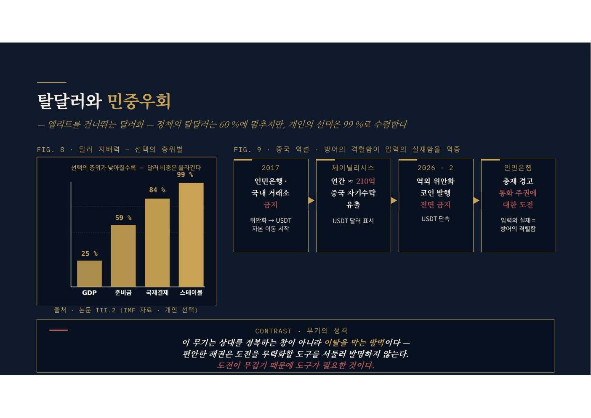

**인도 정부는 자국 정치인 뇌물 수수를 미국에 의뢰해야 한다 (p.95)**

| 항목 | 인도(국내 가시성 ▼) | 미국(역외 가시성 ▲) |
|---|---|---|
| 읽는 힘 | 화폐개혁·UPI로도 지하경제(노동력 80~90%)를 못 읽음 | 공개 원장 + 체이널리시스·TRM·엘립틱 → 주소를 실명 주체로 번역 |
| 끄는 힘 | 은행을 거치지 않아 자국민 지갑 동결 권한 없음 | 테더·서클의 동결·소각 (테더 2025 약 12.6억 USDT 동결, 상당액 미국 당국 요청) |
| 삼중 장악 | 발행자 감독·준비금 관할·온체인 분석 표준이 모두 자국 밖 | 세 관할 확보 → 보유자 국적과 무관하게 시야·집행력 |
| 귀결 | 국내에서 실패한 가시성 혁명 | 역외에서 달성 — 인도 정부 승인 없이 제재·동결·몰수 |

**비트코인 ETF 승인: 디지털 자산의 제도적 포섭 (p.96)**

- 2024.1 현물 ETF 승인 = 투기적 자산을 미국의 규제 금융 인프라 안으로 편입하는 과정
- ETF 래퍼가 자산 흐름의 관찰·공시·보관을 투명하게 → 미국의 통제가능성·규칙설정 능력 증대
- "크립토를 금지하는 것보다, 규제된 래퍼 안으로 끌어들이는 것이 미국의 디지털 puissance를 더 강화할 수 있다."

**비트코인의 발빠른 포획 (p.97)**

- 로컬 국가: 금지·거래 제약·판단 유보 → "유일한 선택지 = 기다림"
- 미국: 흡수·제도화·회수 → "금지 대신, 무정부를 길들이다"
- 사례(2025.10): 프린스그룹(천즈) 관련 127,271 BTC(당시 약 150억 USD), 자기수탁 지갑 4년 잠복 → 온체인 + 오프체인 수사 결합으로 미 법무부 몰수
- 미국이 설계한 소유 구조: ETF(간접 소유·규제 수탁) / 자기수탁의 여백 닫기 / 전략 준비금(정부 직접 보유) / 수사·압수

**자기 방어막을 허무는 패권 (p.98)**

- 세 동기는 모두 수세의 전제, 그 대가는 방어막의 허물어짐
- 미국이 육성하는 달러 스테이블코인이 미국 주도의 AML(자금세탁방지) 국제 공공재를 가장 크게 허무는 통로
- **84% — 2025 불법 크립토 중 스테이블코인 비중** (체이널리시스 2026)

**청문회 Q&A — 스테이블코인 규제 틀의 시작 (p.99)**

- Q(앤디 바 의원): 중국이 CBDC를 추진하는데, 민간 달러 스테이블코인을 장려하는 규제 틀이 더 나은 대안 아닌가
- A(마셜 빌링슬리 증인): CBDC는 감시 도구. 1달러당 준비금 1달러를 보유하는 달러 스테이블코인이 이미 있음
- 2025 GENIUS법의 100% 준비금 의무는 이 청문회의 언어를 법률로 옮긴 것

**2023년 미 하원 달러 청문회는 왜 열렸는가? (p.100)**

| 시점 | 사건 | 의미 |
|---|---|---|
| 2022.02 | 러시아 자산 동결·SWIFT 차단 | 달러의 '무기화' 신호 |
| 2022.08 | BRICS 공통통화 담론 공개화 | 탈달러 논의 가시화 |
| 2022.12 | 사우디 아람코 위안화 결제 논의 | 페트로달러 균열 우려 |
| 2023.03 | 중국 CIPS 확대(120개국) | 비SWIFT 인프라 부상 |
| 2023.05 | 중국 e-CNY 국경간 시범 확대 | CBDC 경쟁 격화 |

- 달러가 중립적 인프라가 아니라 정치적 무기로 인식되기 시작 → 미 의회가 패권의 지속 가능성을 점검

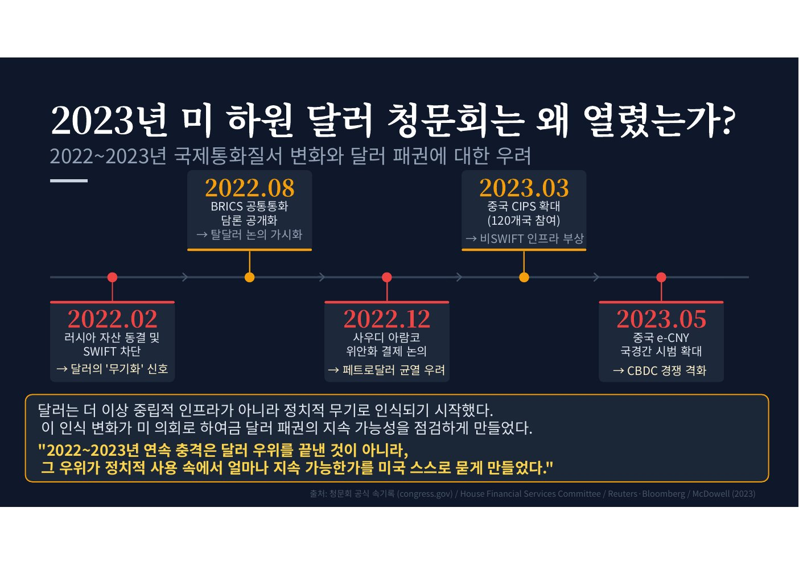

**달러: 글로벌 운영체제와 무기화의 역설 (p.101)**

- 수에즈·호르무즈·말라카 등 해상 chokepoint 위기 시 달러 결제·보험망 접근 통제가 물리적 봉쇄 이상의 강제 수단
- 과도한 제재는 금·위안화·비트코인·CIPS 등 우회로를 촉진 (CIPS 참여율: 제재 경험국 64% vs 비경험국 24%, McDowell)
- 2025 GENIUS Act: 100% 현금·국채 준비금 의무로 새로운 국채 수요 기반 구축

**제재가 온체인으로 확장되다 — 이란 정권 연계 가상자산 동결 (p.102)**

- 베센트 재무장관(2026.5.29): "지갑을 직접 확보했다", 5월 말까지 이란 연계 가상자산 약 10억 달러 압류·동결
- OFAC(6.2): 이란 정권 연계 가상자산 약 5억 달러 동결
- 호르무즈 해협 통행료를 가상자산으로 받는 "크립토 기반 보호비 갈취" 정황(6.2 보도)
- 테더 동결: 2026.4.23 약 3억 4,420만 USDT, 7.14~15 추가 약 1억 3,100만 USDT → 누계 약 4억 7,500만 USDT
- '10억 달러'는 세부 내역 없는 정부 상위 집계치로 다룰 필요(검증 불가 항목 다수)

**인적 연속성 — 증인이 법의 손이 되기까지 (p.103)**

- 마이클 폴켄더: 2023 하원 청문회 증인 → 2025.3.26 상원 인준 → 재무부 부장관
- GENIUS Act(Public Law 119-27): 100% 준비금(현금 + 단기 국채)
- 크립토 제도화는 특정 정권의 취향이 아니라 행정부를 가로질러 지속된 국가전략

**설계를 뒤집다 — 짐으로 읽는 길 (p.104)**

- 같은 사실(미국이 질서의 중심)을 설계론은 '저작'으로, 부담론은 '짐'으로 읽음 — 이 장은 후자가 더 정확하다고 논증
- 네 걸음: 부과의 역사 · 소진의 서명(GDP 반토막, 퓨상스→포스) · 성공의 함정(평화 배당금의 비대칭) · 통합
- 결론: "스트레인지가 명명한 것의 상당 부분은 — 구조적 부담이었다." (레이몽 아롱)

**킨들버거 — 떠받치는 자의 부담 (p.105)**

- 패권국은 착취자가 아니라 비용을 떠안는 공공재 제공자
- 3대 공공재: 최종 시장(과잉 수요 흡수), 최종 대부자(유동성 부족 흡수), 기축통화(거래 단위 표준)
- 비용은 제공자에게 집중, 이득은 무임승차자에게 확산 → 지불인의 계정은 시간이 갈수록 적자로 기욺

**요구의 시대 — 청구서를 꺼내는 강대국 (p.106)**

- 동맹에 방위비 분담 요구, '코스트 플러스 50'(주둔비 50% 가산 구상), NATO 방위비 GDP 2% → 5%
- 헌신을 '요구'해야 한다는 것 자체가 퓨상스가 포스로 전락하는 신호 — 진정한 강대국은 청구서를 꺼낼 필요가 없음

---

## Part 5. 비트코인 4년 주기 (pp.107–111)

**비트코인 4년 주기 가격 흐름 (p.107)** — 2024.01 → 2026.10.13

- 4년 주기 하락(약 48~50%) 이후 2026년 9~10월 8만 달러대 회복
- 2026.09.22 코인베이스 8만5,895달러(8개월 만에 8만5천 달러 회복), 10.06 비트스탬프 주간 종가 8만6,532달러, 10.13 약 8만2,700달러(코인게코)

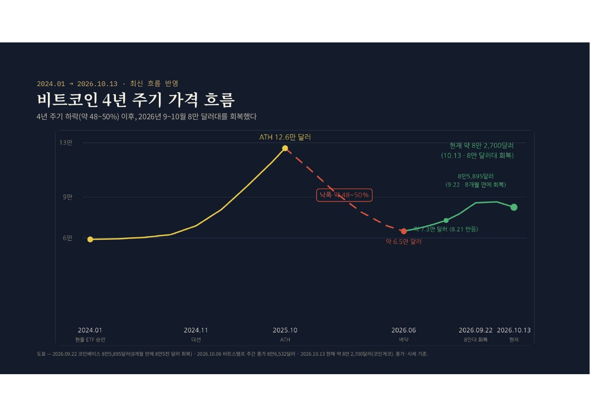

**제4차 사이클 — ETF 승인부터 ATH, 그리고 -50% 조정까지 (p.108)**

| 날짜 | 단계 | 가격 | 설명 |
|---|---|---|---|
| 2024.01.10 | 현물 ETF 승인 | $46,000 | SEC 현물 ETF 11개 동시 승인, 기관 자금 유입 시작 |
| 2024.11.06 | 트럼프 당선·돌파 | $76,000 | 친크립토 정책 기대, 사상최고가 돌파 |
| 2025.10 | 사이클 정점(ATH) | $126,000 | 역대 최고가 12.6만 달러 |
| 2026.06 | 사이클 저점 | $65,000 | ATH 대비 -48~50% |
| 2026.10.13 | 현재·반등 | $83,000 | 3일 만에 반등(Coinbase $82,593) |

- 사이클 상승률 +174%($46k → $126k), ATH→저점 -48~50%, 저점→반등 +12%($65k → $73k, 약 3일), 직전 3번 사이클과 패턴 부합

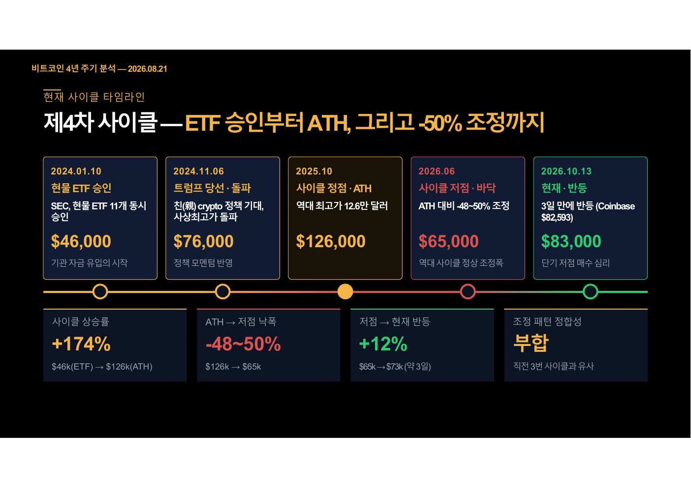

**4번의 반감기, 같은 패턴의 반복 (p.109)**

| 반감기 | 블록 보상 | 특징 |
|---|---|---|
| 2012 (1차) | 50 → 25 BTC | 초기 채굴자·소수 투자자, 사이클 ATH 약 $1,163 |
| 2016 (2차) | 25 → 12.5 BTC | ATH $19,783 후 약 -84% |
| 2020 (3차) | 12.5 → 6.25 BTC | 기관 진입 시작, ATH $69k → -77% |
| 2024 (4차) | 6.25 → 3.125 BTC | 현물 ETF 11개 승인, 기관 자금 본격화 |

- 반감기마다 신규 공급이 절반으로 줄어드는 구조적 희소성 + FOMO → 공포 → FOMO의 반복 심리 = 자산 그 자체의 리듬

**이전 사이클과 다른 점 · 그러나 4년 주기는 여전히 작동 (p.110)**

1. 거품 부재·제도화된 상승: 2017 ICO, 2021 NFT 같은 명시적 거품 없음
2. ETF 순유출 약 43~46억 달러(2026.6 기준): 기관 자금 이탈이 단기 가격 압박
3. 트럼프 행정부 친크립토 정책: 기대 반영 후 매크로·정책 변수로 출렁임
4. 디커플링 가설: ETF로 주기가 깨질 가능성이 제기됐지만 검증된 데이터 없음
- 해석: 거품 붕괴가 아닌 "제도적 사이클의 정상 조정", -48~50%는 사이클 평균 범위 안

**끝나지 않았지만, 변형되고 있다 (p.111)**

- -48~50% 조정 = 역사적 정상 (직전 사이클 -75~85% 대비 부드러운 조정, 제도화로 변동성 축소)
- ETF·기관 자금 = 높아진 바닥($65k)
- 단기 반등(+12%) = 시장이 여전히 4년 주기를 인식
- 방향 결정 구간: 2026년 하반기~2027년 상반기 (11월 중간선거, 9월 FOMC 시그널, 2028.4 반감기 공급 충격)

> ※ 원문 슬라이드 간 수치 차이: p.108 머리말 날짜(2026.08.21)와 2026.10.13 카드 공존, 반등가 $73k(+12%)와 $83k 병기, 스테이블코인 시장 규모 $150B+(p.85) / $305bn(p.79) / 약 3,080억(p.87) 등은 원문 그대로 옮김
